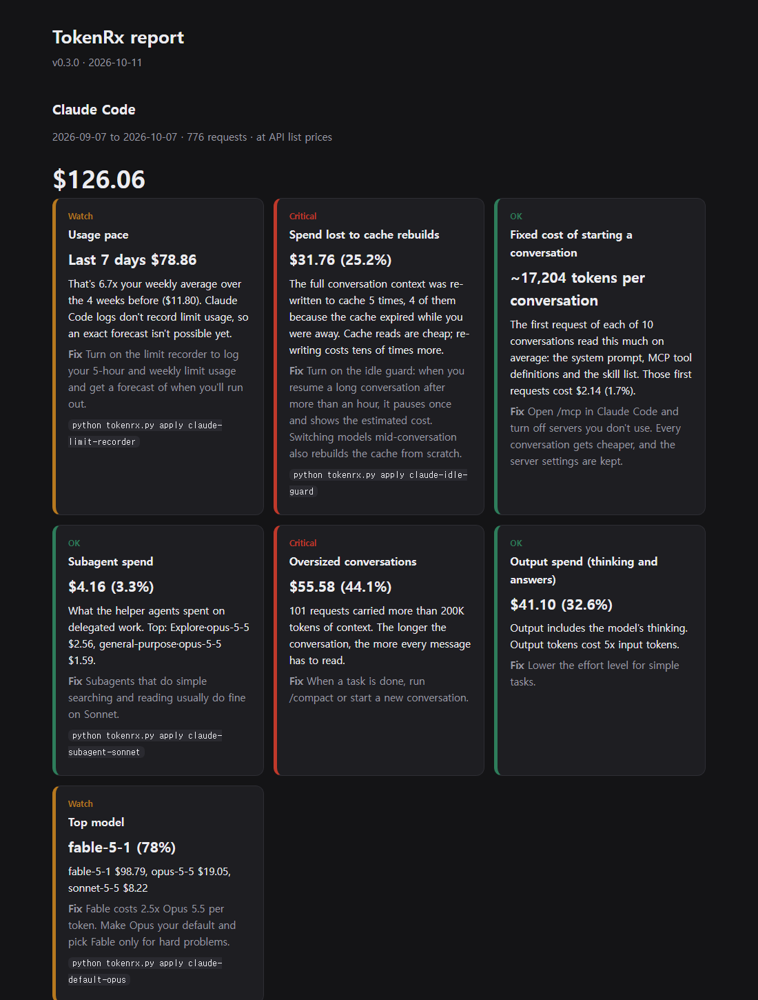

# TokenRx

English | [한국어](README.ko.md)

TokenRx reads your local Claude Code and Codex logs and tells you **where your tokens and usage limits went**. It can then fix the settings that cause the waste. A [Claude Code mod](#the-tokenrx-mod) also shows your limits and the prompt cache as you work, and keeps long chats warm while you're away.



- **Local only.** Nothing leaves your machine, and there is no telemetry.
- **No conversation content in the report.** The report reads token counts and metadata only (model, timestamps, whether a tool was used). The exceptions are the optional idle guard and the mod's new-chat button: when they hand a long conversation over, they write a short handoff note (your recent requests, the last reply, files edited) to a local file so a new conversation can pick up cheaply. That note never leaves your PC.
- **No dependencies.** Python 3.10+ standard library.

## Quick start

```
git clone <this repo>
cd tokenrx
python tokenrx.py
```

You get a summary in the terminal and a full report at `output/report.html`.
Use `--days 14` to look at recent usage only.
The language follows your system (Korean or English); force it with `--lang en` or `--lang ko`, or set `TOKENRX_LANG`.

## What it diagnoses

| Tool | Checks |
|---|---|
| Claude Code | Cache rebuilds: resuming a long conversation after the cache expired, or switching models mid-conversation. Also fixed per-conversation overhead, subagent spend, oversized contexts, failed tool calls, output share, spend by model and usage pace. |
| Codex | Weekly and 5-hour limit forecast, limit burn by reasoning effort, subagent share, cache hit rate, reasoning share, the threads that used the most limit, and errors: turns that failed or were interrupted, and failed commands and MCP calls by cause. |

- **Claude Code:** spend is priced at API list rates. Subscription users don't pay these amounts, but they are a consistent yardstick for how much of your limit went where.
- **Codex:** the logs record actual limit usage (`used_percent`), so the report measures that directly in percentage points.
- **What a fix would have saved:** each finding with a prescription shows how much it would have saved on your past logs. It's an upper bound that assumes you'd have followed the advice, and the estimates overlap, so don't add them up.
- **Did it work?** After you apply a prescription, the report compares the share of spend it targets in the 30 days before and the 14 days after.

### The biggest finding on real data

Prompt-cache reads cost a small fraction of a fresh cache write. Suppose a long conversation (say 500K tokens) has sat idle past the cache TTL. Sending one more message rewrites the whole context at the write price. On real-world logs we tested, this alone was **over 40% of Claude Code usage**. No existing usage meter showed it.

Two more findings:
- **Oversized contexts.** 1M-context models don't auto-compact until about 967K tokens, so every message in a long conversation reads hundreds of thousands of tokens. On the same logs, compacting at 400K would have saved about a third.
- **Errors are mostly your setup, not the model.** In the Codex logs, under 1% of turns ended in a server or model error. About 8% of the agent's own shell commands failed (wrong shell syntax, missing paths, failing builds), and the request right after each failure is the price.

## Prescriptions

```
python tokenrx.py rx              # list prescriptions and their status
python tokenrx.py apply <name>    # backup -> show diff -> ask -> apply
python tokenrx.py undo            # revert the most recent prescription
python tokenrx.py backups         # list backups
```

| Name | What it does |
|---|---|
| `claude-idle-guard` | `UserPromptSubmit` and `SessionStart` hooks. When you resume a long conversation after its cache expired, it pauses once and shows the estimated cost. It also writes a short handoff note. Open a new conversation in the same folder and say "continue": the new conversation is told where the note is, and picks up the work for a few thousand tokens instead of rebuilding the whole context. To go ahead anyway, send the same message again within 10 minutes. |
| `claude-limit-recorder` | A status line that shows 5-hour and weekly limit usage plus time left on the prompt cache, and nudges you to `/compact` before a long conversation's cache runs out. It records limit snapshots so the report can forecast when you'll hit the limit. Works only in `claude` run from a terminal (the Claude desktop app doesn't run status lines; there, the [mod](#the-tokenrx-mod) records limits instead). |
| `claude-autocompact` | Sets `autoCompactWindow` to 400K tokens, so long conversations compact well before the 967K default. Older details get summarized when it compacts. |
| `claude-subagent-sonnet` | Sets `CLAUDE_CODE_SUBAGENT_MODEL=sonnet`. |
| `claude-default-opus` | Sets the default model to Opus. |
| `codex-effort-high` | Sets Codex `model_reasoning_effort = "high"`. |
| `codex-shell-notes` | Adds a few lines to `~/.codex/AGENTS.md` about the shell Codex actually runs in (detected from your logs), so it stops failing on shell syntax. About 85 tokens per request, mostly cached. |

- **Files touched:** `~/.claude/settings.json`, `~/.claude/tokenrx/`, `~/.codex/config.toml` and `~/.codex/AGENTS.md`.
- **Undo:** originals are saved in `backups/`, and `undo` restores them byte for byte.

## The TokenRx mod

The report looks back at your logs. The mod works live inside Claude Code, in the terminal and in the Claude desktop app.

```
claude plugin marketplace add latentcairn/tokenrx
claude plugin install tokenrx@latentcairn
```

It applies to chats started after you install it. If the band doesn't appear, restart the desktop app.

- **A band above the prompt:** 5-hour and weekly limit use, this chat's size and the minutes left on its prompt cache. The model doesn't read the band, so it costs no tokens.
- **Before a long chat's cache cools:** for a chat of 100K+ tokens, it warns once, five minutes before the cache expires. With `keepAlive`, it sends a one-line nudge instead, which refreshes the cache for about 1/40 of rewriting it, for up to the chosen hours after your last message. With `autoCompact on`, it compacts the chat when keep-alive is off or its hours are up.
- **After a long chat has cooled:** the band shows what sending one more message would cost. In the desktop app, a **Continue in a new chat** button writes a handoff note and opens a new chat in the same folder, which starts by reading the note.
- **Desktop app and Remote Control:** recent versions of the desktop app pause a chat a minute or two after you switch away from it, unless it is working, has background tasks or has Remote Control on. The mod pauses with the chat, so it can't keep the cache warm. Turn on Remote Control for long chats, or turn on **Connect new sessions to Remote Control** in the app's settings. With `keepAlive` or `autoCompact` on, the band reminds you when a long chat has it off.
- **Limit log:** each change in your limits is appended to `~/.claude/tokenrx/limits.jsonl`, which the report's limit forecast reads.
- **Tidy chats:** `/tokenrx:tidy`, [below](#tidy-desktop-chats).

Options go in `~/.claude/settings.json`:

```json
"pluginConfigs": {
  "tokenrx@latentcairn": { "options": { "lang": "auto", "autoCompact": "on", "keepAlive": "12h" } }
}
```

| Option | Values | Default |
|---|---|---|
| `lang` | `auto` (follows `TOKENRX_LANG`, then the system language), `ko`, `en` | `auto` |
| `autoCompact` | `off`, `on` | `off` |
| `keepAlive` | `off`, `4h`, `8h`, `12h`, `24h` | `off` |

- `keepAlive` needs a Claude subscription (it relies on the one-hour cache), and the PC and the app must stay on.
- Every decision (nudge, compaction, skip, Remote Control state) is logged to `~/.claude/tokenrx/mod-events.jsonl`.
- In the desktop app, the mod reads the app's own record of the current chat only to see whether Remote Control is on.

## Tidy desktop chats

```
python tokenrx.py sessions        # Claude desktop chats: which to archive or rename, and why (changes nothing)
```

A big chat that has gone cold costs a full cache re-write if you reopen it by mistake. The list flags chats the idle guard handed off, big chats a newer chat in the same folder took over, short test chats, and chats unused for two weeks, plus titles that don't say what the chat is. With the TokenRx mod installed, say "tidy my chats" in the desktop app (`/tokenrx:tidy`): Claude shows the same list, then renames and archives only the chats you pick. Archived chats can be restored anytime; nothing is deleted.

## Try it with synthetic data

```
python examples/make_sample.py sample-data en
python tokenrx.py --claude-home sample-data/claude --codex-home sample-data/codex
```

## Tests

```
python -m unittest discover -s tests                 # parsers, estimates, hooks, prescriptions
python tests/e2e_claude.py <path to claude executable>   # idle guard inside real Claude Code
```

The end-to-end test runs Claude Code in print mode against a throwaway session and settings file, checks that the guard blocks without calling the model, and cleans up after itself.

## Validation

`eval/` is an A/B harness that checks whether two prescriptions save tokens without making Claude Code worse at the task. There are no published results yet.

| Experiment | Arms | What it measures |
|---|---|---|
| `autocompact` | Auto-compact at 1M (control) or 400K (treatment) | The first message sets six exact requirements. The model then reviews about 560K tokens of code and docs, implements a feature and runs the tests. Hidden checks score each requirement. |
| `handoff` | Keep going in the same conversation, or start a new one from the idle guard's handoff note | A conversation of about 230K tokens makes decisions along the way, and the follow-up task depends on them. Both arms start from the same state. |

```
python eval/run.py --exp autocompact --model claude-haiku-5-5 --trials 10 --estimate   # expected tokens and cost; runs nothing
python eval/run.py --exp handoff --trials 2 --out eval-out/dry --dry-run               # the whole pipeline with a fake claude
python eval/run.py --claude <path to claude> --preflight                               # two tiny real calls to check the setup
python eval/run.py --claude <path to claude> --exp autocompact --model claude-haiku-5-5 --trials 10 --out eval-out/ac-haiku
```

- **It uses your limit.** Real runs go through your subscription. Run `--estimate` first, and use a full model id such as `claude-haiku-5-5`. `--budget` stops starting new trials once spend reaches a limit. Running again with the same `--out` adds more trials.
- **Each trial is isolated.** It runs in a new temporary folder with `--setting-sources project`, its own `--settings` and no MCP servers. The model only gets Read, Glob, Grep, Edit, Write and Python commands. Afterwards the transcripts move to `<out>/transcripts/`, `claude purge` clears what Claude Code kept about the folder, and the folder is deleted. Your own usage report is unaffected.
- **How it scores.** Hidden checks are copied in only after the conversation ends. The visible tests and a final recall quiz are scored too. The summary shows the pass rate (Fisher exact and paired McNemar tests), mean tokens by type, mean cost with a bootstrap 95% interval for the difference, compactions per trial and the size of the first request. For `handoff`, it also shows what continuing would have cost had the cache expired.
- Results are written to `<out>/trials.jsonl` and `<out>/summary.json`.

## Caveats

- **The Claude Code log format can change.** It is internal and undocumented, so it may change between versions. Unknown lines are skipped.
- **Large Codex logs are slow once.** The first run over several GB of logs can take about a minute. Results are cached in `cache/`, so later runs take seconds.
- **The limit recorder has requirements.** It needs a Claude Pro or Max subscription and only records where the status line is shown.
- **The mod API is early access.** It may change between Claude Code versions, and so may how the desktop app pauses idle chats.

## License

MIT © latentcairn
