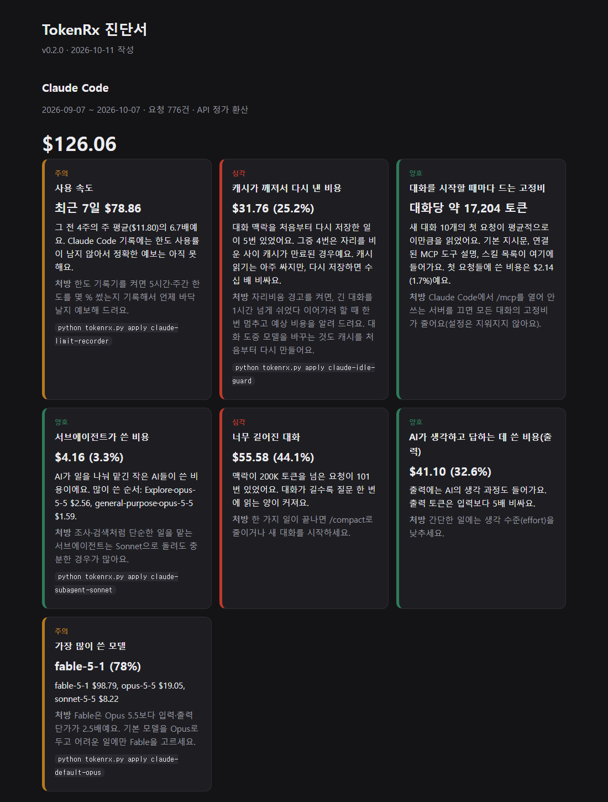

# TokenRx

English | [한국어](README.ko.md)

TokenRx reads your local Claude Code and Codex logs and tells you **where your tokens and usage limits went**. It can then fix the settings that cause the waste.



- **Local only.** Nothing leaves your machine, and there is no telemetry.
- **No conversation content.** It reads token counts and metadata only (model, timestamps, whether a tool was used).
- **No dependencies.** Python 3.10+ standard library.

> The report and CLI messages are in Korean for now. English output is planned.

## Quick start

```
git clone <this repo>
cd tokenrx
python tokenrx.py
```

You get a summary in the terminal and a full report at `output/report.html`.
Use `--days 14` to look at recent usage only.

## What it diagnoses

| Tool | Checks |
|---|---|
| Claude Code | Cache rebuilds: resuming a long conversation after the cache expired, or switching models mid-conversation. Also fixed per-conversation overhead, subagent spend, oversized contexts, output share, spend by model and usage pace. |
| Codex | Weekly and 5-hour limit forecast, limit burn by reasoning effort, subagent share, cache hit rate, reasoning share, and the threads that used the most limit. |

- **Claude Code:** spend is priced at API list rates. Subscription users don't pay these amounts, but they are a consistent yardstick for how much of your limit went where.
- **Codex:** the logs record actual limit usage (`used_percent`), so the report measures that directly in percentage points.

### The biggest finding on real data

Prompt-cache reads cost a small fraction of a fresh cache write. Suppose a long conversation (say 500K tokens) has sat idle past the cache TTL. Sending one more message rewrites the whole context at the write price. On real-world logs we tested, this alone was **over 40% of Claude Code usage**. No existing usage meter showed it.

## Prescriptions

```
python tokenrx.py rx              # list prescriptions and their status
python tokenrx.py apply <name>    # backup -> show diff -> ask -> apply
python tokenrx.py undo            # revert the most recent prescription
python tokenrx.py backups         # list backups
```

| Name | What it does |
|---|---|
| `claude-idle-guard` | A `UserPromptSubmit` hook. When you resume a long conversation after its cache expired, it pauses once and shows the estimated cost. Send the same message again within 10 minutes to go ahead. |
| `claude-limit-recorder` | A status line that shows 5-hour and weekly limit usage plus time left on the prompt cache. It records limit snapshots so the report can forecast when you'll hit the limit. |
| `claude-subagent-sonnet` | Sets `CLAUDE_CODE_SUBAGENT_MODEL=sonnet`. |
| `claude-default-opus` | Sets the default model to Opus. |
| `codex-effort-high` | Sets Codex `model_reasoning_effort = "high"`. |

- **Files touched:** `~/.claude/settings.json`, `~/.claude/tokenrx/` and `~/.codex/config.toml`.
- **Undo:** originals are saved in `backups/`, and `undo` restores them byte for byte.

## Try it with synthetic data

```
python examples/make_sample.py sample-data
python tokenrx.py --claude-home sample-data/claude --codex-home sample-data/codex
```

## Caveats

- **The Claude Code log format can change.** It is internal and undocumented, so it may change between versions. Unknown lines are skipped.
- **Large Codex logs are slow once.** The first run over several GB of logs can take about a minute. Results are cached in `cache/`, so later runs take seconds.
- **The limit recorder has requirements.** It needs a Claude Pro or Max subscription and only records where the status line is shown.

## License

MIT © latentcairn
